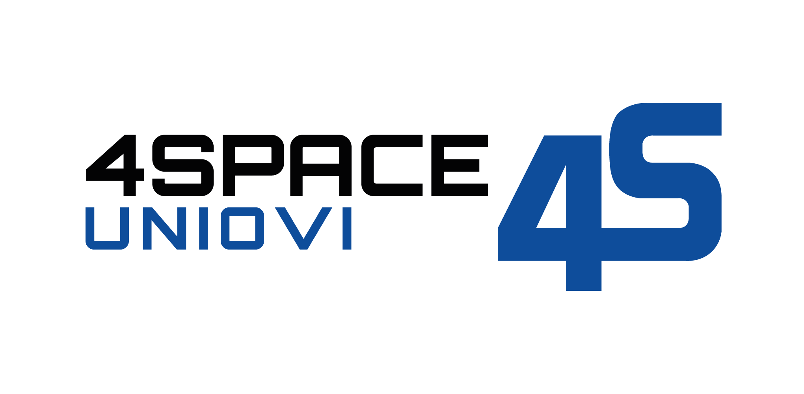
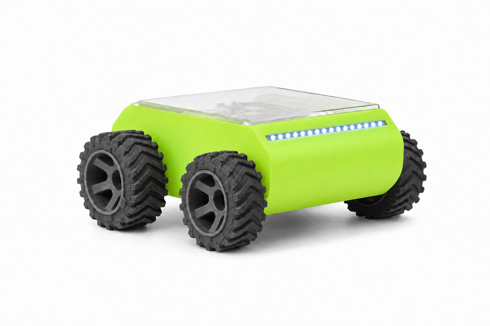
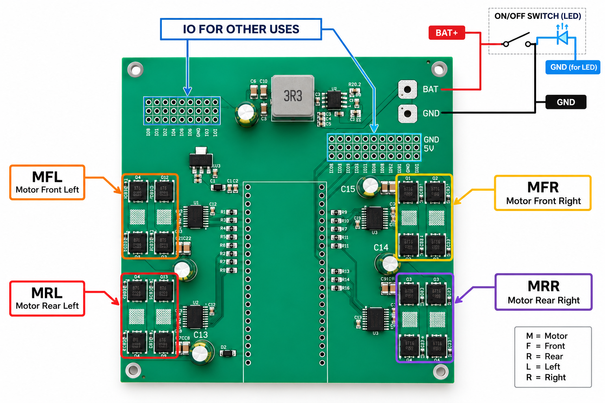

<p align="center">
  
</p>

<p align="center">
  <a href="https://4space.es"></a>
</p>

# XERA — eXploration & Education Robotics Architecture

XERA is a low-cost, modular rover for educational robotics, developed by [4Space](https://4space.es) (4Space UniOvi), a student engineering team from the University of Oviedo focused on planetary rover technologies.

It is built to be understood and modified: you 3D print the parts, assemble the chassis, wire the electronics, program it, and then grow it with sensors (IMU, GNSS), a Raspberry Pi, ROS 2, computer vision and autonomous navigation.

XERA can be built from scratch (DIY), from a kit, or used pre-assembled.

<p align="center">
  
  <br>
  <em>XERA fully assembled: 3D printed chassis, four-wheel drive and acrylic lid.</em>
</p>

## This repository

| Folder | Contents |
|---|---|
| [`firmware/`](firmware) | ESP32-S3 firmware (PlatformIO). Drives the 4 motors and the LEDs from a simple serial protocol. |
| [`examples/python/`](examples/python) | Sample code to drive the rover from Python. |
| [`img/`](img) | Logos, photos and the board schematic used in this README. |

## Electronics

XERA uses a custom board with an ESP32-S3, four H-bridge motor drivers (one per wheel), a buck converter for the 5 V rail and two expansion headers for your own sensors and peripherals.

<p align="center">
  
</p>

| Label | Meaning |
|---|---|
| **MFL** | Motor Front Left |
| **MFR** | Motor Front Right |
| **MRL** | Motor Rear Left |
| **MRR** | Motor Rear Right |
| **BAT / GND** | Battery input. An optional ON/OFF switch (with LED) goes in series with BAT+. |
| **IO FOR OTHER USES** | Free GPIO headers (with GND and 5 V) to connect your own sensors. |

### Pinout used by the firmware

All motors use an H-bridge with two PWM inputs (high side, `HA`/`HB`) and two digital inputs (low side, `LA`/`LB`).

| Motor | Position | Board label | HA (PWM) | HB (PWM) | LA | LB |
|---|---|---|---|---|---|---|
| M1 | Rear left | MRL | GPIO 17 | GPIO 18 | GPIO 15 | GPIO 16 |
| M2 | Rear right | MRR | GPIO 40 | GPIO 37 | GPIO 36 | GPIO 35 |
| M3 | Front left | MFL | GPIO 7 | GPIO 6 | GPIO 5 | GPIO 4 |
| M4 | Front right | MFR | GPIO 1 | GPIO 2 | GPIO 42 | GPIO 41 |

| Function | Pin | Notes |
|---|---|---|
| Status LED (onboard RGB, WS2812-type) | GPIO 38 | ESP32-S3-DevKitC-1 **v1.1**. On v1.0 boards the LED is on GPIO 48: change `LED_PIN` in the firmware. |
| Serial / USB | Native USB (CDC) | 115200 baud |

PWM runs at 1 kHz with 8-bit resolution on the 8 `HA`/`HB` pins.

## Quick start

### 1. Flash the firmware

Install [PlatformIO](https://platformio.org/) (Core 6.2 or newer) and, from `firmware/`:

```bash
pio run -t upload
pio device monitor
```

### 2. Drive it from Python

```bash
pip install pyserial
python examples/python/drive.py COM5   # or /dev/ttyACM0 on Linux / Raspberry Pi
```

## Reversing the motor direction

Depending on how you wire each motor, one or more wheels may spin the wrong way (the rover goes backwards when you ask it to go forward, or a side turns against the other).

You don't need to touch the wiring. In [`firmware/src/main.cpp`](firmware/src/main.cpp) there is one constant per motor:

```cpp
//  1 = normal direction
// -1 = reversed direction
#define M1_DIR  1   // rear left
#define M2_DIR -1   // rear right
#define M3_DIR  1   // front left
#define M4_DIR  1   // front right
```

To reverse a motor, change its `1` to `-1` (or the other way round) and flash again:

```bash
cd firmware
pio run -t upload
```

Tips to find which motors to flip:

1. Lift the rover so the wheels are in the air.
2. Send `50,0` (forward). All four wheels must spin forward.
3. Every wheel that spins backwards needs its `Mx_DIR` toggled.
4. Send `0,50` (rotate in place). The left and right sides must spin in opposite directions. If they don't, you reversed a whole side by mistake.

If the rover goes forward correctly but turns to the wrong side, swap the sign in the differential mix inside `loop()`:

```cpp
int izquierda = velocidad + giro;   // swap to velocidad - giro
int derecha   = velocidad - giro;   // swap to velocidad + giro
```

## Control protocol

The ESP32 listens on its native USB serial port (115200 baud, 8N1) for text lines:

```
throttle,steering\n
```

Both values are integers from `-100` to `100`.

| Command | Result |
|---|---|
| `100,0` | forward |
| `-100,0` | backward |
| `50,30` | forward while turning right |
| `50,-30` | forward while turning left |
| `0,100` | rotate in place (right) |
| `0,0` | stop |

Each accepted command is acknowledged with `RECEIVED -> Throttle: … Steering: …`. Values outside the range are ignored.

The maximum PWM is set by `velocidadLinealMax` (forward/backward) and `velocidadGiroMax` (turning) in the firmware.

**LED status** (onboard RGB LED): blue breathing = idle, solid orange = moving, blinking orange = turning.

## About

XERA is developed within [4Space](https://4space.es) UniOvi at the University of Oviedo, with the support of the Ingenium program.

<p align="center">
  <a href="https://4space.es"></a>
</p>

Built with ❤️ in Asturias.
