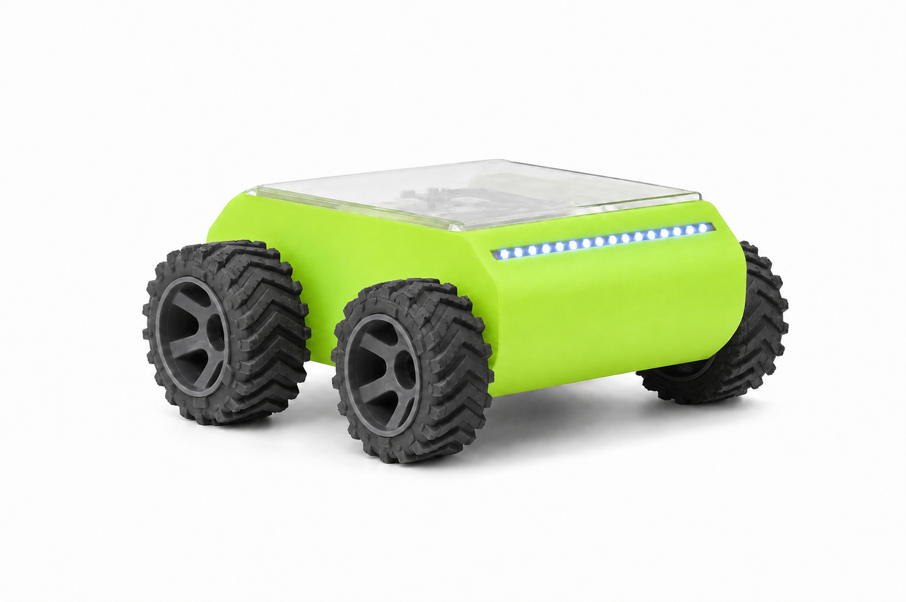
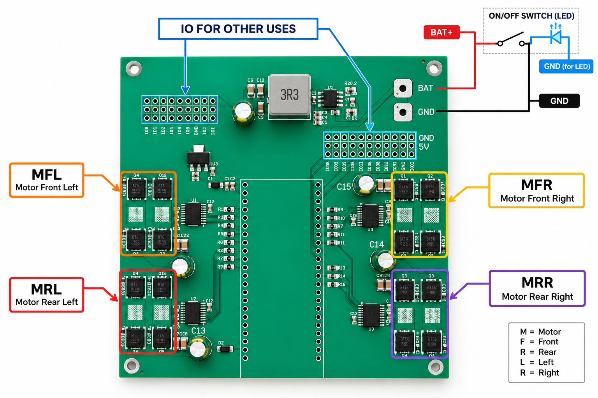

<p align="center">
  
</p>

<p align="center">
  <a href="https://4space.es"></a>
</p>

# XERA — eXploration & Education Robotics Architecture

XERA is a low-cost, modular rover for educational robotics, developed by [4Space](https://4space.es) (4Space UniOvi), a student engineering team from the University of Oviedo focused on planetary rover technologies.

It is built to be understood and modified: you 3D print the parts, assemble the chassis, wire the electronics, program it, and then grow it with sensors (IMU, GNSS), a Raspberry Pi, ROS 2, computer vision and autonomous navigation.

XERA can be built from scratch (DIY), from a kit, or used pre-assembled.

<p align="center">
  
  <br>
  <em>XERA fully assembled: 3D printed chassis, four-wheel drive and acrylic lid.</em>
</p>

## This repository

| Folder | Contents |
|---|---|
| [`firmware/`](firmware) | ESP32-S3 firmware (PlatformIO). Drives the 4 motors and the LEDs from a simple serial protocol. |
| [`examples/python/`](examples/python) | Sample code to drive the rover from Python. |
| [`rover/`](rover) | Web control app (live video + virtual joystick) for the onboard Linux computer (Arduino UNO Q / Raspberry Pi), with install scripts, systemd service and tests. |
| [`img/`](img) | Logos, photos and the board schematic used in this README. |

## Electronics

XERA uses a custom board with an ESP32-S3, four H-bridge motor drivers (one per wheel), a buck converter for the 5 V rail and two expansion headers for your own sensors and peripherals.

<p align="center">
  
</p>

| Label | Meaning |
|---|---|
| **MFL** | Motor Front Left |
| **MFR** | Motor Front Right |
| **MRL** | Motor Rear Left |
| **MRR** | Motor Rear Right |
| **BAT / GND** | Battery input. An optional ON/OFF switch (with LED) goes in series with BAT+. |
| **IO FOR OTHER USES** | Free GPIO headers (with GND and 5 V) to connect your own sensors. |

### Pinout used by the firmware

All motors use an H-bridge with two PWM inputs (high side, `HA`/`HB`) and two digital inputs (low side, `LA`/`LB`).

| Motor | Position | Board label | HA (PWM) | HB (PWM) | LA | LB |
|---|---|---|---|---|---|---|
| M1 | Rear left | MRL | GPIO 17 | GPIO 18 | GPIO 15 | GPIO 16 |
| M2 | Rear right | MRR | GPIO 40 | GPIO 37 | GPIO 36 | GPIO 35 |
| M3 | Front left | MFL | GPIO 7 | GPIO 6 | GPIO 5 | GPIO 4 |
| M4 | Front right | MFR | GPIO 1 | GPIO 2 | GPIO 42 | GPIO 41 |

| Function | Pin | Notes |
|---|---|---|
| Status LED (onboard RGB, WS2812-type) | GPIO 38 | ESP32-S3-DevKitC-1 **v1.1**. On v1.0 boards the LED is on GPIO 48: change `LED_PIN` in the firmware. |
| Serial / USB | Native USB (CDC) | 115200 baud |

PWM runs at 1 kHz with 8-bit resolution on the 8 `HA`/`HB` pins.

## Quick start

### 1. Flash the firmware

Install [PlatformIO](https://platformio.org/) (Core 6.2 or newer) and, from `firmware/`:

```bash
pio run -t upload                 # env "xera": Serial on the native USB port
pio run -e xera-uart -t upload    # env "xera-uart": Serial on the UART port (CH343 chip)
pio device monitor
```

Use the environment that matches the USB-C connector you plug into the computer. If you flash the wrong one,
the rover compiles and uploads fine but stops answering, because `Serial` lives on the other connector.

### 2. Drive it from Python

```bash
pip install pyserial
python examples/python/drive.py COM5   # or /dev/ttyACM0 on Linux / Raspberry Pi
```

### 3. Deploy the web control app (GUI) on the rover

The [`rover/`](rover) folder is a web app that runs on the rover's onboard Linux computer
(Arduino UNO Q or Raspberry Pi) and talks to the ESP32-S3 over USB. From any phone, tablet or
laptop on the same network you get:

- **Live video** from a USB webcam (MJPEG, 640x480 @ 15 fps).
- A **virtual joystick** (touch or mouse) and an emergency **STOP** button.
- A **max-speed limit** (20-100 %) and **single-driver control**: only one person drives at a time,
  the others can watch.
- A **status page** (ESP32, serial port, webcam, IP, connected clients) and a **settings page**.

Everything runs as a systemd service that starts on boot. No Docker, no ROS 2, no frontend build step;
no Internet is needed once it is installed.

#### What you need

| | |
|---|---|
| Onboard computer | Arduino UNO Q (Debian 13, ARM64) or a Raspberry Pi with a 64-bit Debian-based OS, reachable over SSH. |
| ESP32-S3 | Flashed with the firmware in [`firmware/`](firmware) (step 1), connected to the computer by USB (a hub is fine). The firmware must be the version with the **command watchdog**. |
| Webcam (optional) | Any USB UVC camera that can output MJPEG. |
| Internet | Only during the installation (`apt` / `pip`). |

#### Install

On the rover's computer (over SSH):

```bash
git clone https://github.com/4space-uniovi/xera.git
cd xera
./install.sh          # asks before every system change; add --yes to accept all
./doctor.sh           # checks everything and tells you how to fix what is missing
```

`./install.sh` is safe to run again. It: checks the architecture, installs the missing apt packages
(`python3-venv`, `v4l-utils`, `git`), creates the Python virtual environment in `rover/.venv`, makes sure your user
is in the `dialout` / `video` / `gpiod` groups, installs a udev rule (stable `/dev/xera-esp32` link, keeps ModemManager
away from the ESP32), saves the rover name, and installs and starts the `4space-rover` systemd service.
Useful options: `--rover-id 03` (names the rover `4SPACE-ROVER-03`), `--dry-run` (only shows what it would do),
`--no-service` (no systemd, for a development PC). It does **not** touch the network settings.

> If it adds you to a group, log out and back in once so your shell picks it up.

#### Open the GUI

Find the rover's IP (`./doctor.sh` prints it, or run `hostname -I`) and open, from a device on the same network:

```
http://<rover-ip>:8000
```

1. Tab **Control** → **Request control** → drag the joystick. Release it and the rover stops.
   **STOP** stops it at once. The slider sets the maximum speed.
2. Tab **Estado** shows the ESP32, serial port, webcam, IP and who is driving.
3. Tab **Ajustes** edits the rover name, serial port, baud rate, camera and maximum speed
   (saved to `rover/config/rover.yaml`).

The two RGB LEDs of the Arduino UNO Q show the state: **solid green** = ESP32 connected and ready,
**blinking red** = the ESP32 is missing or failing.

#### First test (safety)

1. Put the rover on a stand so the **wheels do not touch the ground**.
2. The first run should use a low speed: set it to 20 % in the GUI (or in `rover/config/rover.yaml`:
   `motion.max_speed: 20`).
3. Push the joystick forward: all four wheels must spin forward; if one spins backwards, change its
   `Mx_DIR` as explained in [Reversing the motor direction](#reversing-the-motor-direction).
4. Pull the USB cable while a wheel is spinning: it must stop within about half a second
   (firmware watchdog). If it does not, you are running a firmware without the watchdog: flash the current one.

#### Safety built in

| Situation | What happens |
|---|---|
| The driver releases the joystick or presses STOP | `0,0` is sent immediately. |
| The driver's browser disconnects | The backend sends `0,0` and frees the control. |
| No valid command for 300 ms | Backend watchdog: `0,0`. |
| No command for 400 ms at the ESP32 (cable out, process dead) | Firmware watchdog: motors stop. |
| Two people try to drive | Only the first gets control; the other is told it is taken. |

> The web app has **no login**. Anyone who can reach port 8000 can drive the rover, so use it on a network you trust.
> A Wi-Fi hotspot mode for the rover is planned but not implemented yet: for now the rover joins an existing Wi-Fi network.

#### Update, logs and uninstall

```bash
./update.sh                          # git pull + apply the changes (restarts the service only if needed)
systemctl status 4space-rover        # is it running?
journalctl -u 4space-rover -f        # live logs
sudo systemctl restart 4space-rover  # after editing Python code
./rover/scripts/uninstall.sh         # remove the service (keeps code and settings)
```

Changes in `rover/frontend/` (HTML/CSS/JS) show up when you reload the page; no restart needed.

#### Try it on a PC (no rover, no ESP32, no webcam)

```bash
cd rover
python3 -m venv .venv && .venv/bin/pip install -r requirements-dev.txt
./scripts/dev.sh          # demo mode (simulated ESP32) on http://localhost:8000
.venv/bin/python -m pytest   # tests, no hardware needed
```

#### Troubleshooting

Start with `./doctor.sh`. Common cases:

| Symptom | Fix |
|---|---|
| The page does not load | Check the service: `systemctl status 4space-rover`; use the IP of the rover and port `8000`, on the same network. |
| "ESP32 disconnected" / blinking red LEDs | `ls /dev/ttyACM* /dev/xera-esp32`; check the USB cable/hub; your user must be in `dialout`. |
| Wheels turn on the spot when you push forward | Protocol order mismatch: the firmware expects `throttle,steering` (this app already sends it that way); make sure you run the current version (`./update.sh`). |
| Rover keeps going if the cable is pulled | Old firmware without the watchdog: flash the current one. |
| "Webcam disconnected" | `./rover/scripts/test_camera.sh`; the camera must support MJPEG. `/dev/video0`/`video1` on the UNO Q are not webcams. |
| Serial port busy | Close the PlatformIO serial monitor (or any program using the port) while the service is running. |

More documentation: [`rover/docs/`](rover/docs) (architecture, UART protocol, installation).

## Reversing the motor direction

Depending on how you wire each motor, one or more wheels may spin the wrong way (the rover goes backwards when you ask it to go forward, or a side turns against the other).

You don't need to touch the wiring. In [`firmware/src/main.cpp`](firmware/src/main.cpp) there is one constant per motor:

```cpp
//  1 = normal direction
// -1 = reversed direction
#define M1_DIR  1   // rear left
#define M2_DIR -1   // rear right
#define M3_DIR  1   // front left
#define M4_DIR  1   // front right
```

To reverse a motor, change its `1` to `-1` (or the other way round) and flash again:

```bash
cd firmware
pio run -t upload
```

Tips to find which motors to flip:

1. Lift the rover so the wheels are in the air.
2. Send `50,0` (forward). All four wheels must spin forward.
3. Every wheel that spins backwards needs its `Mx_DIR` toggled.
4. Send `0,50` (rotate in place). The left and right sides must spin in opposite directions. If they don't, you reversed a whole side by mistake.

If the rover goes forward correctly but turns to the wrong side, swap the sign in the differential mix inside `loop()`:

```cpp
int izquierda = velocidad + giro;   // swap to velocidad - giro
int derecha   = velocidad - giro;   // swap to velocidad + giro
```

## Control protocol

The ESP32 listens on its native USB serial port (115200 baud, 8N1) for text lines:

```
throttle,steering\n
```

Both values are integers from `-100` to `100`.

| Command | Result |
|---|---|
| `100,0` | forward |
| `-100,0` | backward |
| `50,30` | forward while turning right |
| `50,-30` | forward while turning left |
| `0,100` | rotate in place (right) |
| `0,0` | stop |

**Safety watchdog:** if no valid command arrives for 400 ms (`COMMAND_TIMEOUT_MS`) the rover stops
(`0,0`) and prints `WATCHDOG -> no command, stopped`. Hosts must resend the command continuously
(at least 5 Hz; the Python example and the web app send 20 Hz). A command typed once in the serial
monitor therefore only lasts 400 ms.

Each accepted command is acknowledged with `RECEIVED -> Throttle: … Steering: …`. Values outside the range are ignored.

The maximum PWM is set by `velocidadLinealMax` (forward/backward) and `velocidadGiroMax` (turning) in the firmware.

**LED status** (onboard RGB LED): blue breathing = idle, solid orange = moving, blinking orange = turning.

## About

XERA is developed within [4Space](https://4space.es) UniOvi at the University of Oviedo, with the support of the Ingenium program.

<p align="center">
  <a href="https://4space.es"></a>
</p>

Built with ❤️ in Asturias.
